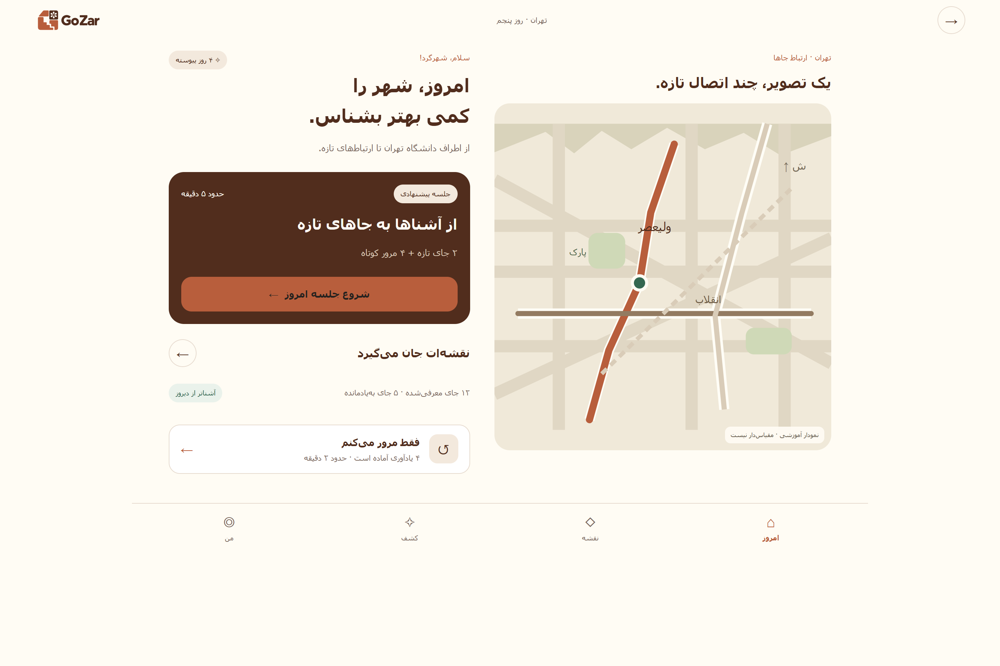
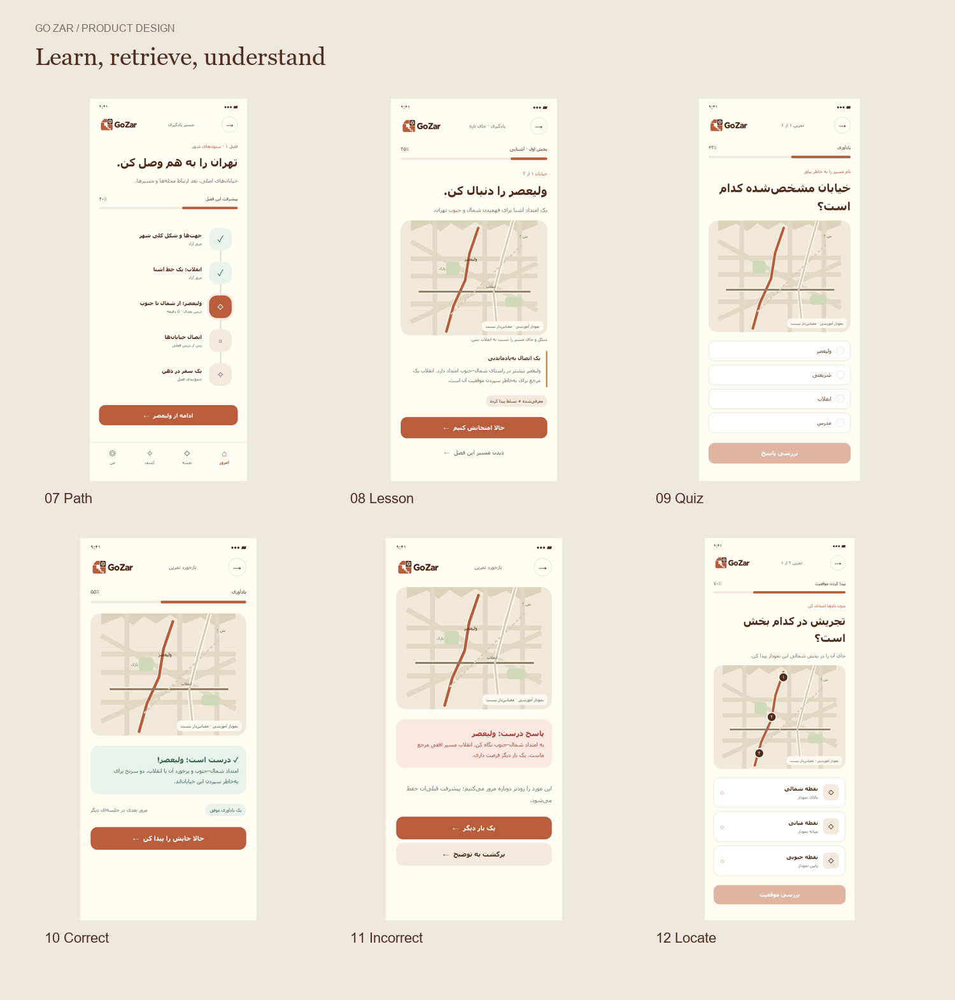

# GoZar


GoZar is a Persian-first app for learning the geography of a city, starting with Tehran. The experience pairs short lessons with map exercises and spaced review so familiar places, landmarks, and routes become easier to recall.

## What you can try today

- **Browser prototype** shows the complete design journey with sample content. Choose interests and important places, try a lesson, answer a question, locate a place on the map, and explore review and progress screens.
- **Windows app** provides native MAUI page shells and a Debug screen catalog. Use the catalog from Welcome to inspect onboarding, lessons, the map, reviews, stories, and preferences while those views are being developed.
- **API** implements account registration, confirmed-email login, token refresh, recovery, and authenticator setup. Learning, catalog, profile, and content routes have contracts and service scaffolds. Operations that still need implementation return HTTP 501.

## Design preview





Open the [clickable prototype](Gozar.Statics/Design/START-HERE.html) in Edge or Chrome, or browse the [screen gallery](Gozar.Statics/Design/01-prototype/gallery.html). Select **Today** to try a sample session. The browser preview works locally and uses illustrative maps, progress, and story content.

## Solution structure

| Project | Role | Where to start |
| --- | --- | --- |
| [GoZar.Api](GoZar.Api/GoZar.Api.csproj) | ASP.NET Core API on .NET 10 with Identity, EF Core, and SQL Server | [Feature controllers and services](GoZar.Api/Features), [domain models](GoZar.Api/Domain), and [migrations](GoZar.Api/Migrations) |
| [GoZar.Maui](GoZar.Maui/GoZar.Maui.csproj) | Windows-only .NET MAUI app with RTL views, view models, Shell navigation, and a Debug catalog | [App shell](GoZar.Maui/AppShell.xaml), [feature pages](GoZar.Maui/Features), and [frontend guide](GoZar.Maui/README.md) |
| [Gozar.Statics](Gozar.Statics/Gozar.Statics.csproj) | Design source, screenshots, tokens, implementation notes, and branding assets | [Design pack](Gozar.Statics/Design/README.md) and [logo kit](Gozar.Statics/Logo/README.md) |

The prototype and the native app are separate. HTML, CSS, and JavaScript live in `Gozar.Statics/Design/01-prototype`. Native UI lives in `GoZar.Maui/Features`. The frontend guide tracks the remaining API and session integration.

## Run locally

### Windows app

Use Windows with the .NET 10 SDK and the .NET MAUI Windows workload.

```powershell
dotnet build GoZar.Maui/GoZar.Maui.csproj -c Debug
```

In Visual Studio, select `GoZar.Maui` as the startup project and choose **Windows Machine**. Open the developer screen catalog from Welcome in a Debug build. It previews native pages without creating a session or loading server data.

### API and database

Set `ConnectionStrings__DefaultConnection` to your development SQL Server connection string before running the API or EF tooling. The repository contains Identity migrations and an initial application-model migration for the catalog, curriculum, learning, content, and profile schemas. Review them before applying them to a development database. Schema creation is a separate step from implementing and populating the learning features.

```powershell
$env:ConnectionStrings__DefaultConnection = 'Server=(LocalDB)\MSSQLLocalDB;Database=GoZarDev;Integrated Security=True;TrustServerCertificate=True;'
dotnet ef database update --project GoZar.Api/GoZar.Api.csproj --context AppDbContext
dotnet run --project GoZar.Api/GoZar.Api.csproj --launch-profile https
```

The migration command requires `dotnet-ef`. In Development, open [Swagger UI](https://localhost:7208/swagger) or use the [HTTP examples](GoZar.Api/Requests). Configure the `Email` settings for account confirmation and recovery and provide credentials through local secrets or environment variables. See the [authentication guide](GoZar.Api/AUTHENTICATION.md) for the full configuration.

## Further reading

- [Design system and components](Gozar.Statics/Design/03-design-system/components.html)
- [Learning and MAUI implementation handoff](Gozar.Statics/Design/04-handoff/implementation-notes.md)
- [API feature scaffold](GoZar.Api/README.md)

